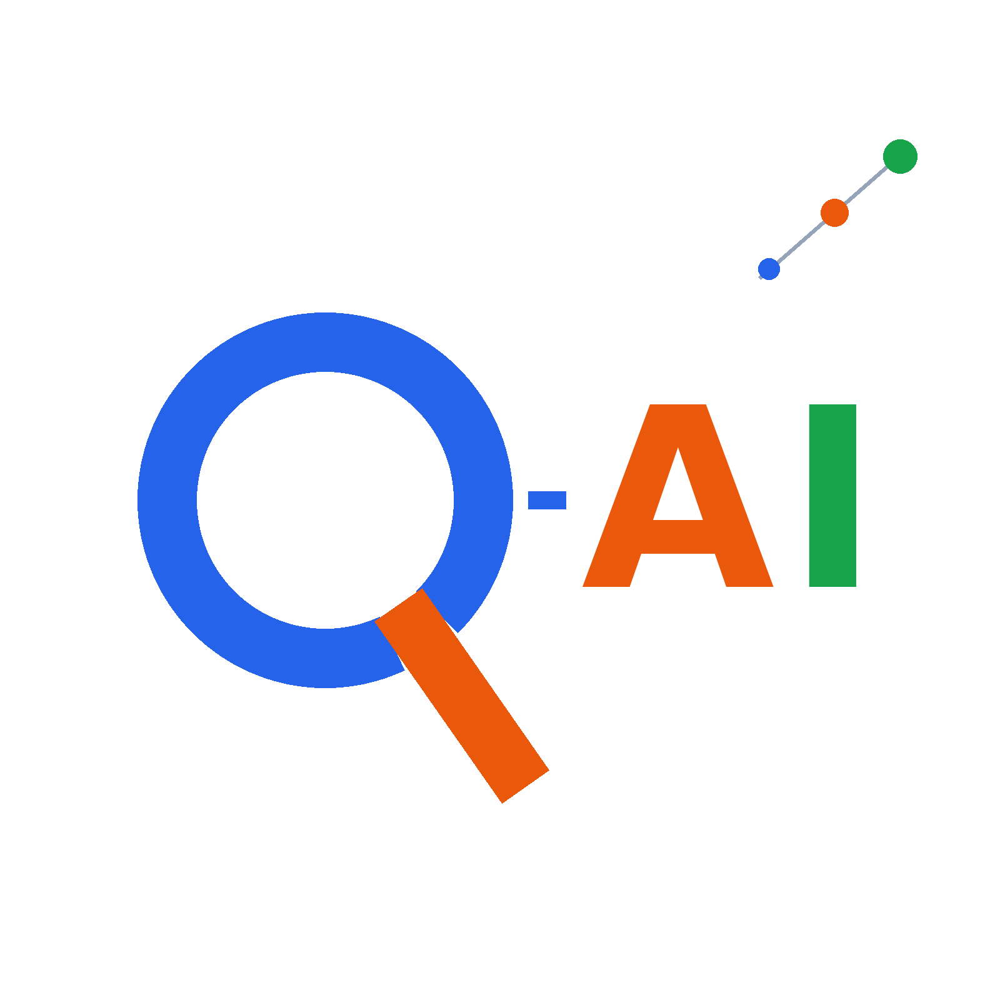

<p align="center">
  <a href="https://github.com/QuanLHK-FSC-HAG/Q-AI">
    <picture>
      <source srcset=".github/assets/qai-logo.png" media="(prefers-color-scheme: dark)">
      <source srcset=".github/assets/qai-logo.png" media="(prefers-color-scheme: light)">
      
    </picture>
  </a>
</p>
<p align="center">وكيل برمجة بالذكاء الاصطناعي مفتوح المصدر.</p>
<p align="center">
  <a href="https://github.com/QuanLHK-FSC-HAG/Q-AI/discussions"></a>
  <a href="https://www.npmjs.com/package/@opencode/cli"></a>
  <a href="https://github.com/QuanLHK-FSC-HAG/Q-AI/actions/workflows/release.yml"></a>
</p>

<p align="center">
  <a href="README.md">English</a> |
  <a href="README.zh.md">简体中文</a> |
  <a href="README.zht.md">繁體中文</a> |
  <a href="README.ko.md">한국어</a> |
  <a href="README.de.md">Deutsch</a> |
  <a href="README.es.md">Español</a> |
  <a href="README.fr.md">Français</a> |
  <a href="README.it.md">Italiano</a> |
  <a href="README.da.md">Dansk</a> |
  <a href="README.ja.md">日本語</a> |
  <a href="README.pl.md">Polski</a> |
  <a href="README.ru.md">Русский</a> |
  <a href="README.bs.md">Bosanski</a> |
  <a href="README.ar.md">العربية</a> |
  <a href="README.no.md">Norsk</a> |
  <a href="README.br.md">Português (Brasil)</a> |
  <a href="README.th.md">ไทย</a> |
  <a href="README.tr.md">Türkçe</a> |
  <a href="README.uk.md">Українська</a> |
  <a href="README.bn.md">বাংলা</a> |
  <a href="README.gr.md">Ελληνικά</a> |
  <a href="README.vi.md">Tiếng Việt</a>
</p>

[](https://github.com/QuanLHK-FSC-HAG/Q-AI)

---

### التثبيت

```bash
# YOLO
curl -fsSL https://opencode.ai/v2/install | bash

# مديري الحزم
npm i -g @opencode/cli@latest      # او bun/pnpm/yarn
brew install anomalyco/tap/opencode-v2 # macOS و Linux (موصى به، دائما محدث)
brew install opencode              # macOS و Linux (صيغة brew الرسمية، تحديث اقل)
sudo pacman -S opencode            # Arch Linux (Stable)
paru -S opencode-beta              # Arch Linux (Latest from AUR)
mise use -g opencode               # اي نظام
nix run github:anomalyco/opencode  # Nix
```

> [!TIP]
> احذف الاصدارات الاقدم من 0.1.x قبل التثبيت.

### تطبيق سطح المكتب (BETA)

يتوفر Q-AI ايضا كتطبيق سطح مكتب. قم بالتنزيل من [opencode.ai/download](https://github.com/QuanLHK-FSC-HAG/Q-AI/releases).

| المنصة                | التنزيل                            |
| --------------------- | ---------------------------------- |
| macOS (Apple Silicon) | `opencode-desktop-mac-arm64.dmg`   |
| macOS (Intel)         | `opencode-desktop-mac-x64.dmg`     |
| Windows               | `opencode-desktop-win-x64.exe`     |
| Linux                 | `.deb` او `.rpm` او AppImage       |

```bash
# macOS (Homebrew)
brew install --cask opencode-desktop
```

#### مجلد التثبيت

يثبت سكربت التثبيت Q-AI في `$HOME/.opencode/bin`.

### Agents

يتضمن Q-AI وكيليْن (Agents) مدمجين يمكنك التبديل بينهما باستخدام زر `Tab`.

- **build** - الافتراضي، وكيل بصلاحيات كاملة لاعمال التطوير
- **plan** - وكيل للقراءة فقط للتحليل واستكشاف الكود
  - يرفض تعديل الملفات افتراضيا
  - يطلب الاذن قبل تشغيل اوامر bash
  - مثالي لاستكشاف قواعد كود غير مألوفة او لتخطيط التغييرات

بالاضافة الى ذلك يوجد وكيل فرعي **general** للبحث المعقد والمهام متعددة الخطوات.
يستخدم داخليا ويمكن استدعاؤه بكتابة `@general` في الرسائل.

تعرف على المزيد حول [agents](https://github.com/QuanLHK-FSC-HAG/Q-AI#documentation/agents).

### التوثيق

لمزيد من المعلومات حول كيفية ضبط Q-AI، [**راجع التوثيق**](https://github.com/QuanLHK-FSC-HAG/Q-AI#documentation).

### المساهمة

اذا كنت مهتما بالمساهمة في Q-AI، يرجى قراءة [contributing docs](./CONTRIBUTING.md) قبل ارسال pull request.

### البناء فوق Q-AI

اذا كنت تعمل على مشروع مرتبط بـ Q-AI ويستخدم "opencode" كجزء من اسمه (مثل "opencode-dashboard" او "opencode-mobile")، يرجى اضافة ملاحظة في README توضح انه ليس مبنيا بواسطة فريق Q-AI ولا يرتبط بنا بأي شكل.

---

**انضم الى مجتمعنا** [Discord](https://github.com/QuanLHK-FSC-HAG/Q-AI/discussions) | [X.com](https://github.com/QuanLHK-FSC-HAG/Q-AI)
