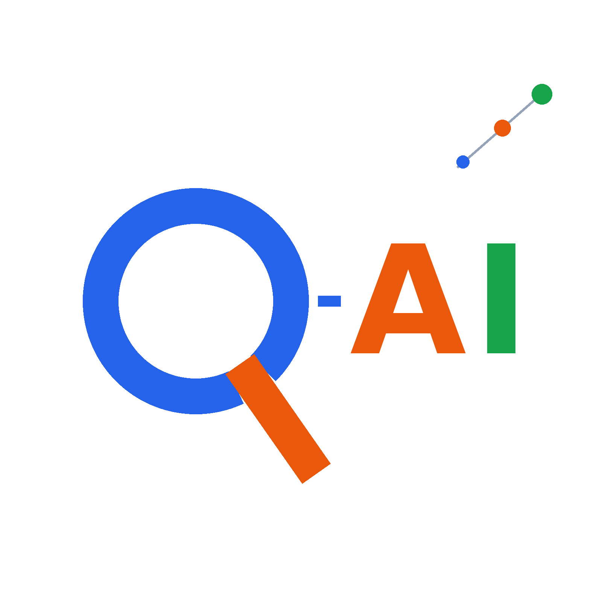

<p align="center">
  <a href="https://github.com/QuanLHK-FSC-HAG/Q-AI">
    <picture>
      <source srcset=".github/assets/qai-logo.png" media="(prefers-color-scheme: dark)">
      <source srcset=".github/assets/qai-logo.png" media="(prefers-color-scheme: light)">
      
    </picture>
  </a>
</p>
<p align="center">Q-AI je open source AI agent za programiranje.</p>
<p align="center">
  <a href="https://github.com/QuanLHK-FSC-HAG/Q-AI/discussions"></a>
  <a href="https://www.npmjs.com/package/@opencode/cli"></a>
  <a href="https://github.com/QuanLHK-FSC-HAG/Q-AI/actions/workflows/release.yml"></a>
</p>

<p align="center">
  <a href="README.md">English</a> |
  <a href="README.zh.md">简体中文</a> |
  <a href="README.zht.md">繁體中文</a> |
  <a href="README.ko.md">한국어</a> |
  <a href="README.de.md">Deutsch</a> |
  <a href="README.es.md">Español</a> |
  <a href="README.fr.md">Français</a> |
  <a href="README.it.md">Italiano</a> |
  <a href="README.da.md">Dansk</a> |
  <a href="README.ja.md">日本語</a> |
  <a href="README.pl.md">Polski</a> |
  <a href="README.ru.md">Русский</a> |
  <a href="README.bs.md">Bosanski</a> |
  <a href="README.ar.md">العربية</a> |
  <a href="README.no.md">Norsk</a> |
  <a href="README.br.md">Português (Brasil)</a> |
  <a href="README.th.md">ไทย</a> |
  <a href="README.tr.md">Türkçe</a> |
  <a href="README.uk.md">Українська</a> |
  <a href="README.bn.md">বাংলা</a> |
  <a href="README.gr.md">Ελληνικά</a> |
  <a href="README.vi.md">Tiếng Việt</a>
</p>

[](https://github.com/QuanLHK-FSC-HAG/Q-AI)

---

### Instalacija

```bash
# YOLO
curl -fsSL https://opencode.ai/v2/install | bash

# Package manageri
npm i -g @opencode/cli@latest      # ili bun/pnpm/yarn
brew install anomalyco/tap/opencode-v2 # macOS i Linux (preporučeno, uvijek ažurno)
brew install opencode              # macOS i Linux (zvanična brew formula, rjeđe se ažurira)
sudo pacman -S opencode            # Arch Linux (Stable)
paru -S opencode-beta              # Arch Linux (Latest from AUR)
mise use -g opencode               # Bilo koji OS
nix run github:anomalyco/opencode  # Nix
```

> [!TIP]
> Ukloni verzije starije od 0.1.x prije instalacije.

### Desktop aplikacija (BETA)

Q-AI je dostupan i kao desktop aplikacija. Preuzmi je sa [opencode.ai/download](https://github.com/QuanLHK-FSC-HAG/Q-AI/releases).

| Platforma             | Preuzimanje                        |
| --------------------- | ---------------------------------- |
| macOS (Apple Silicon) | `opencode-desktop-mac-arm64.dmg`   |
| macOS (Intel)         | `opencode-desktop-mac-x64.dmg`     |
| Windows               | `opencode-desktop-win-x64.exe`     |
| Linux                 | `.deb`, `.rpm`, ili AppImage       |

```bash
# macOS (Homebrew)
brew install --cask opencode-desktop
```

#### Instalacijski direktorij

Instalacijska skripta instalira Q-AI u `$HOME/.opencode/bin`.

### Agenti

Q-AI uključuje dva ugrađena agenta između kojih možeš prebacivati tasterom `Tab`.

- **build** - Podrazumijevani agent sa punim pristupom za razvoj
- **plan** - Agent samo za čitanje za analizu i istraživanje koda
  - Podrazumijevano zabranjuje izmjene datoteka
  - Traži dozvolu prije pokretanja bash komandi
  - Idealan za istraživanje nepoznatih codebase-ova ili planiranje izmjena

Uključen je i **general** pod-agent za složene pretrage i višekoračne zadatke.
Koristi se interno i može se pozvati pomoću `@general` u porukama.

Saznaj više o [agentima](https://github.com/QuanLHK-FSC-HAG/Q-AI#documentation/agents).

### Dokumentacija

Za više informacija o konfiguraciji Q-AI-a, [**pogledaj dokumentaciju**](https://github.com/QuanLHK-FSC-HAG/Q-AI#documentation).

### Doprinosi

Ako želiš doprinositi Q-AI-u, pročitaj [upute za doprinošenje](./CONTRIBUTING.md) prije slanja pull requesta.

### Gradnja na Q-AI-u

Ako radiš na projektu koji je povezan s Q-AI-om i koristi "opencode" kao dio naziva, npr. "opencode-dashboard" ili "opencode-mobile", dodaj napomenu u svoj README da projekat nije napravio Q-AI tim i da nije povezan s nama.

---

**Pridruži se našoj zajednici** [Discord](https://github.com/QuanLHK-FSC-HAG/Q-AI/discussions) | [X.com](https://github.com/QuanLHK-FSC-HAG/Q-AI)
