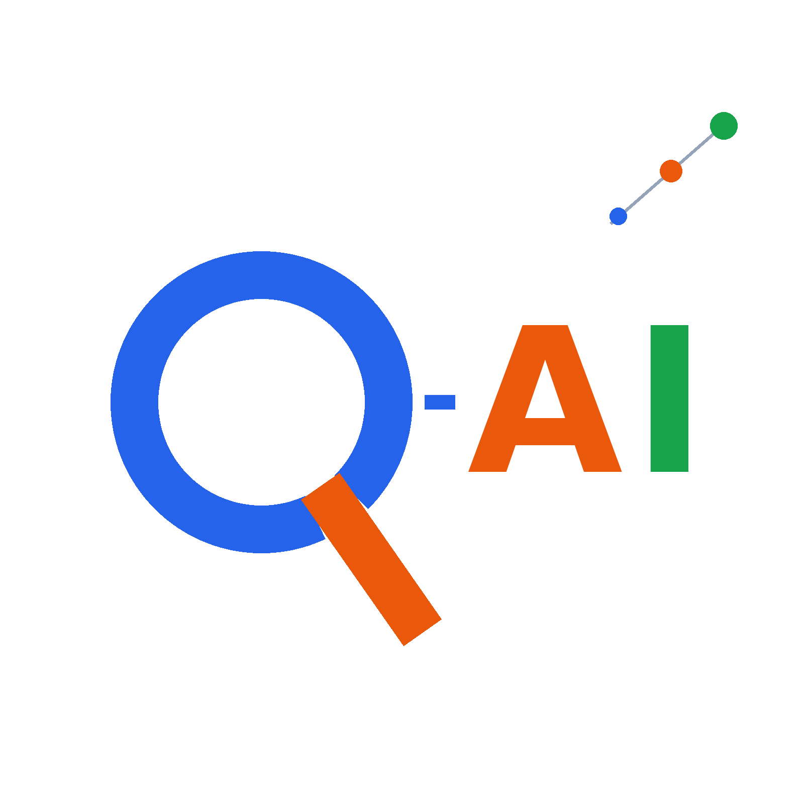

<p align="center">
  
</p>

<h1 align="center">Q-AI</h1>
<p align="center">An open-source AI coding assistant.</p>
<p align="center"><em>Designed by QuanLHK with AI</em></p>

> Q-AI is a desktop-first fork maintained independently from its upstream project. Its desktop UI, application identity, icons, and public documentation use the Q-AI brand.

## What is Q-AI?

Q-AI helps you explore a codebase, plan changes, edit files, and run development tasks with an AI coding agent. It includes:

- A desktop application for Windows, macOS, and Linux builds.
- Built-in **build** and **plan** agents.
- Workspace-aware sessions, tools, MCP, plugins, skills, and configurable providers.
- Vietnamese interface support.

## Run locally on Windows

### Prerequisites

- [Bun](https://bun.sh/)
- Node.js-compatible development environment
- Windows with Electron support

### Install dependencies

```powershell
cd qai-fork
bun install --frozen-lockfile
```

### Start the desktop application

```powershell
cd packages/desktop
$env:PATH = "C:\Users\LENOVO\AppData\Roaming\npm\node_modules\bun\bin;" + $env:PATH
bun run dev
```

> The extra `PATH` entry is required in this local Windows environment so Electron can start the Bun-based background service.

### Build the desktop application

```powershell
cd packages/desktop
bun run build
```

## Configuration and compatibility

Q-AI keeps selected upstream technical identifiers—such as package namespaces, protocol/storage keys, and CLI configuration names—where retaining them is necessary for compatibility. These identifiers are implementation details and are not the Q-AI product name.

For example, an existing configuration file or environment variable may retain an `opencode`/`OPENCODE_` technical identifier until the underlying service is migrated safely. Do not rename those values manually unless the corresponding runtime support has been migrated too.

## Development

- The primary fork source is in `qai-fork/`.
- Do not modify `upstream-opencode/`; it is retained for audit and comparison.
- Run the canonical validation from the fork root:

```bash
bun run check
```

## Documentation

- Project status and release checklist: [`docs/Q-AI_PROJECT_CHECKLIST.md`](docs/Q-AI_PROJECT_CHECKLIST.md)
- Fork pin and change list: [`docs/M1_FORK_PIN_AND_CHANGE_LIST.md`](docs/M1_FORK_PIN_AND_CHANGE_LIST.md)
- Audit report: [`docs/M0_AUDIT_REPORT.md`](docs/M0_AUDIT_REPORT.md)

## Attribution and notices

Q-AI preserves upstream licensing and notices. See [`LICENSE`](LICENSE) and [`NOTICE`](NOTICE). The Q-AI product attribution is **Designed by QuanLHK with AI**.
