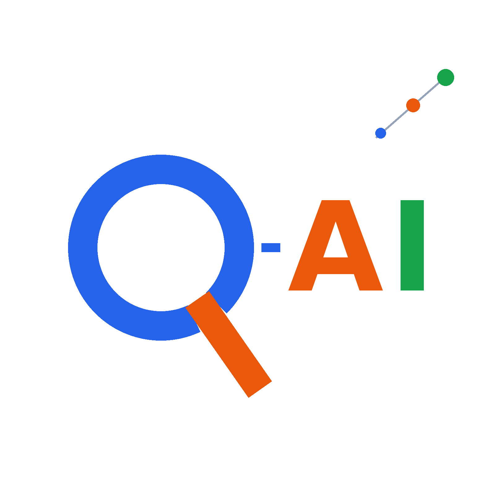
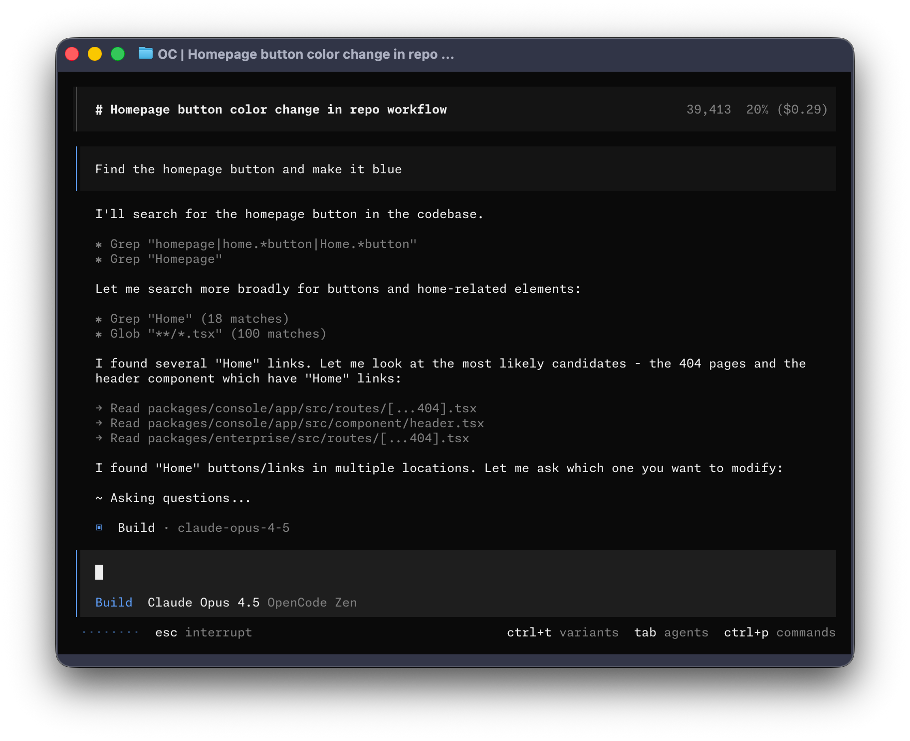

<p align="center">
  <a href="https://github.com/QuanLHK-FSC-HAG/Q-AI">
    <picture>
      <source srcset=".github/assets/qai-logo.png" media="(prefers-color-scheme: dark)">
      <source srcset=".github/assets/qai-logo.png" media="(prefers-color-scheme: light)">
      
    </picture>
  </a>
</p>
<p align="center">AI-kodeagent med åpen kildekode.</p>
<p align="center">
  <a href="https://github.com/QuanLHK-FSC-HAG/Q-AI/discussions"></a>
  <a href="https://www.npmjs.com/package/@opencode/cli"></a>
  <a href="https://github.com/QuanLHK-FSC-HAG/Q-AI/actions/workflows/release.yml"></a>
</p>

<p align="center">
  <a href="README.md">English</a> |
  <a href="README.zh.md">简体中文</a> |
  <a href="README.zht.md">繁體中文</a> |
  <a href="README.ko.md">한국어</a> |
  <a href="README.de.md">Deutsch</a> |
  <a href="README.es.md">Español</a> |
  <a href="README.fr.md">Français</a> |
  <a href="README.it.md">Italiano</a> |
  <a href="README.da.md">Dansk</a> |
  <a href="README.ja.md">日本語</a> |
  <a href="README.pl.md">Polski</a> |
  <a href="README.ru.md">Русский</a> |
  <a href="README.bs.md">Bosanski</a> |
  <a href="README.ar.md">العربية</a> |
  <a href="README.no.md">Norsk</a> |
  <a href="README.br.md">Português (Brasil)</a> |
  <a href="README.th.md">ไทย</a> |
  <a href="README.tr.md">Türkçe</a> |
  <a href="README.uk.md">Українська</a> |
  <a href="README.bn.md">বাংলা</a> |
  <a href="README.gr.md">Ελληνικά</a> |
  <a href="README.vi.md">Tiếng Việt</a>
</p>

[](https://github.com/QuanLHK-FSC-HAG/Q-AI)

---

### Installasjon

```bash
# YOLO
curl -fsSL https://opencode.ai/v2/install | bash

# Pakkehåndterere
npm i -g @opencode/cli@latest      # eller bun/pnpm/yarn
brew install anomalyco/tap/opencode-v2 # macOS og Linux (anbefalt, alltid oppdatert)
brew install opencode              # macOS og Linux (offisiell brew-formel, oppdateres sjeldnere)
sudo pacman -S opencode            # Arch Linux (Stable)
paru -S opencode-beta              # Arch Linux (Latest from AUR)
mise use -g opencode               # alle OS
nix run github:anomalyco/opencode  # Nix
```

> [!TIP]
> Fjern versjoner eldre enn 0.1.x før du installerer.

### Desktop-app (BETA)

Q-AI er også tilgjengelig som en desktop-app. Last ned fra [opencode.ai/download](https://github.com/QuanLHK-FSC-HAG/Q-AI/releases).

| Plattform             | Nedlasting                         |
| --------------------- | ---------------------------------- |
| macOS (Apple Silicon) | `opencode-desktop-mac-arm64.dmg`   |
| macOS (Intel)         | `opencode-desktop-mac-x64.dmg`     |
| Windows               | `opencode-desktop-win-x64.exe`     |
| Linux                 | `.deb`, `.rpm` eller AppImage      |

```bash
# macOS (Homebrew)
brew install --cask opencode-desktop
```

#### Installasjonsmappe

Installasjonsskriptet installerer Q-AI i `$HOME/.opencode/bin`.

### Agents

Q-AI har to innebygde agents du kan bytte mellom med `Tab`-tasten.

- **build** - Standard, agent med full tilgang for utviklingsarbeid
- **plan** - Skrivebeskyttet agent for analyse og kodeutforsking
  - Nekter filendringer som standard
  - Spør om tillatelse før bash-kommandoer
  - Ideell for å utforske ukjente kodebaser eller planlegge endringer

Det finnes også en **general**-subagent for komplekse søk og flertrinnsoppgaver.
Den brukes internt og kan kalles via `@general` i meldinger.

Les mer om [agents](https://github.com/QuanLHK-FSC-HAG/Q-AI#documentation/agents).

### Dokumentasjon

For mer info om hvordan du konfigurerer Q-AI, [**se dokumentasjonen**](https://github.com/QuanLHK-FSC-HAG/Q-AI#documentation).

### Bidra

Hvis du vil bidra til Q-AI, les [contributing docs](./CONTRIBUTING.md) før du sender en pull request.

### Bygge på Q-AI

Hvis du jobber med et prosjekt som er relatert til Q-AI og bruker "opencode" som en del av navnet; for eksempel "opencode-dashboard" eller "opencode-mobile", legg inn en merknad i README som presiserer at det ikke er bygget av Q-AI-teamet og ikke er tilknyttet oss på noen måte.

---

**Bli med i fellesskapet** [Discord](https://github.com/QuanLHK-FSC-HAG/Q-AI/discussions) | [X.com](https://github.com/QuanLHK-FSC-HAG/Q-AI)
