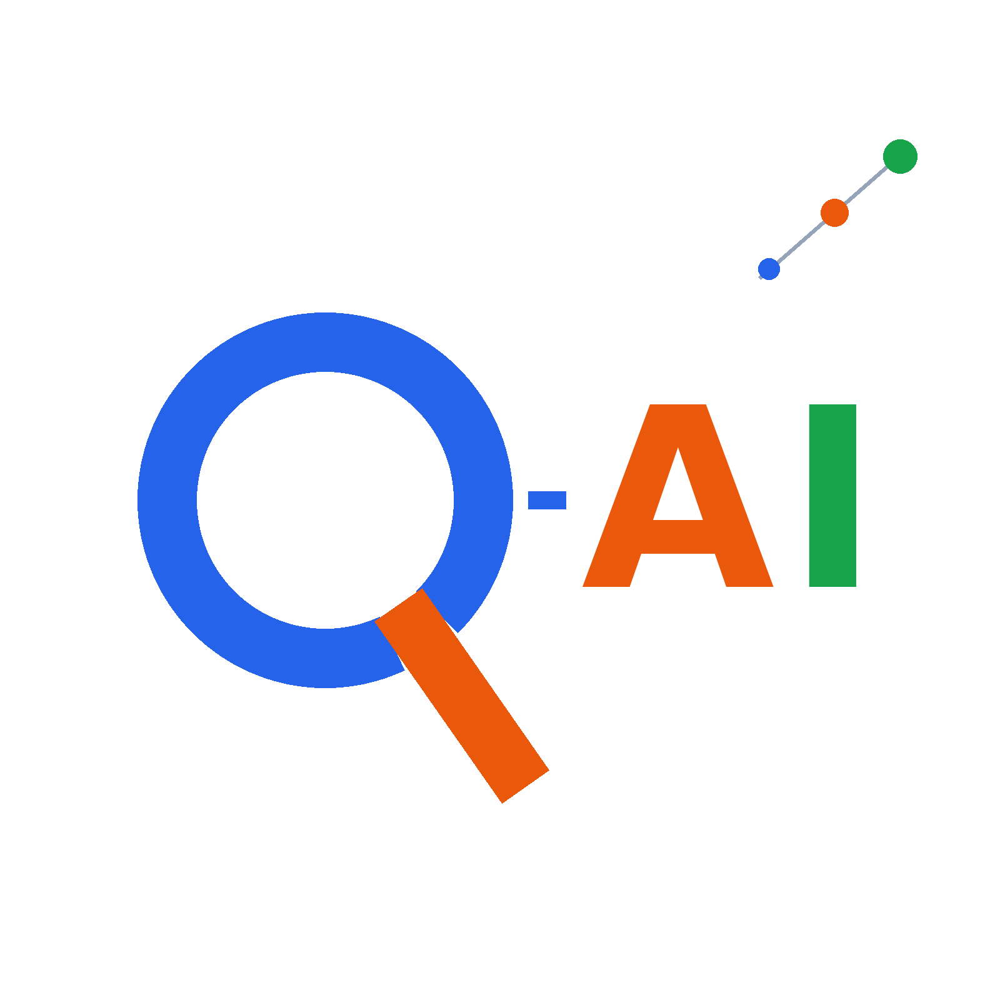

<p align="center">
  
</p>

<h1 align="center">Q-AI</h1>
<p align="center">Trợ lý lập trình AI mã nguồn mở.</p>
<p align="center"><em>Designed by QuanLHK with AI</em></p>

> Q-AI là fork độc lập, ưu tiên trải nghiệm desktop. Giao diện, nhận diện ứng dụng, icon và tài liệu công khai sử dụng thương hiệu Q-AI.

## Q-AI là gì?

Q-AI hỗ trợ bạn khám phá codebase, lập kế hoạch thay đổi, chỉnh sửa tệp và chạy tác vụ phát triển cùng tác nhân lập trình AI. Sản phẩm gồm:

- Ứng dụng desktop cho Windows, cùng các bản build macOS và Linux.
- Hai agent tích hợp: **build** và **plan**.
- Session theo workspace, tools, MCP, plugin, kỹ năng và nhà cung cấp mô hình có thể cấu hình.
- Giao diện tiếng Việt.

## Chạy local trên Windows

### Điều kiện cần

- [Bun](https://bun.sh/)
- Môi trường phát triển tương thích Node.js
- Windows có thể chạy Electron

### Cài dependencies

```powershell
cd qai-fork
bun install --frozen-lockfile
```

### Khởi chạy ứng dụng desktop

```powershell
cd packages/desktop
$env:PATH = "C:\Users\LENOVO\AppData\Roaming\npm\node_modules\bun\bin;" + $env:PATH
bun run dev
```

> Dòng thêm `PATH` là cần thiết trong môi trường Windows local này để Electron có thể khởi chạy background service dùng Bun.

### Build ứng dụng desktop

```powershell
cd packages/desktop
bun run build
```

## Cấu hình và tương thích

Để không phá vỡ khả năng tương thích, Q-AI vẫn giữ một số định danh kỹ thuật upstream, ví dụ namespace package, protocol/storage key và tên cấu hình CLI. Đây là chi tiết triển khai, **không phải tên sản phẩm Q-AI**.

Ví dụ: file cấu hình hoặc biến môi trường hiện hữu có thể còn chứa định danh kỹ thuật `opencode`/`OPENCODE_` cho tới khi dịch vụ phía dưới được migrate an toàn. Không tự đổi các giá trị này nếu runtime tương ứng chưa được migrate.

## Phát triển

- Mã nguồn fork chính nằm trong `qai-fork/`.
- Không sửa `upstream-opencode/`; thư mục này được giữ để audit và đối chiếu.
- Chạy kiểm tra chuẩn tại thư mục gốc của fork:

```bash
bun run check
```

## Tài liệu

- Tiến độ dự án và checklist phát hành: [`docs/Q-AI_PROJECT_CHECKLIST.md`](docs/Q-AI_PROJECT_CHECKLIST.md)
- Fork pin và danh sách thay đổi: [`docs/M1_FORK_PIN_AND_CHANGE_LIST.md`](docs/M1_FORK_PIN_AND_CHANGE_LIST.md)
- Báo cáo audit: [`docs/M0_AUDIT_REPORT.md`](docs/M0_AUDIT_REPORT.md)

## Ghi nhận và thông báo

Q-AI giữ nguyên giấy phép và thông báo của upstream. Xem [`LICENSE`](LICENSE) và [`NOTICE`](NOTICE). Attribution của sản phẩm Q-AI là **Designed by QuanLHK with AI**.
